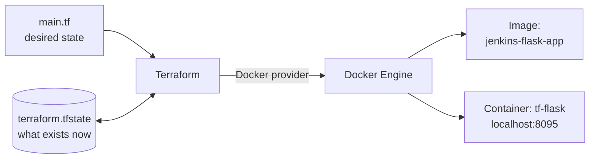
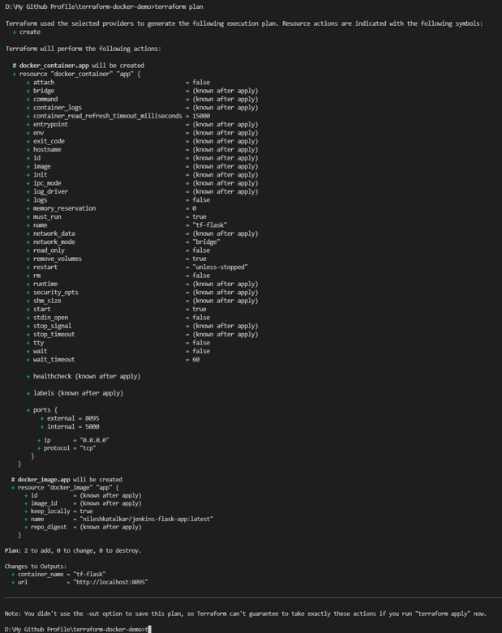
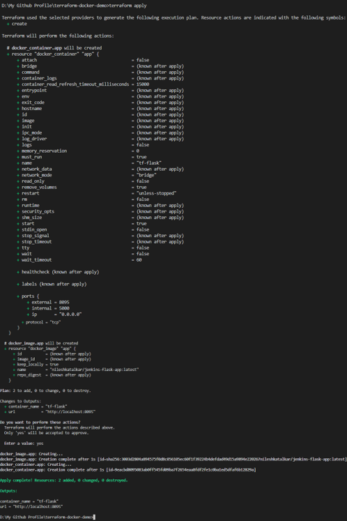
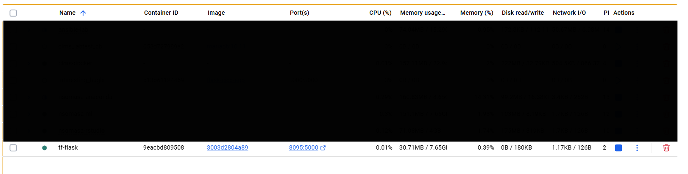
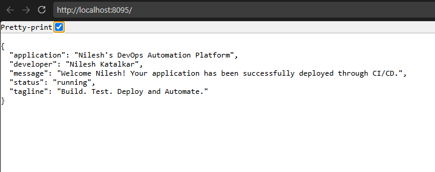
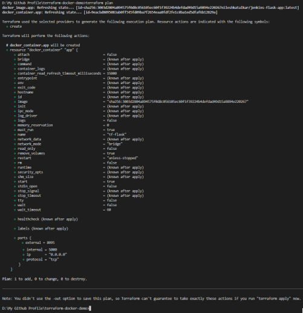

# Infrastructure as Code with Terraform and Docker

A Terraform configuration that creates and manages a Docker container running my Flask app, using the Docker provider. The project practises the full Terraform workflow (`init`, `plan`, `apply`, `destroy`) on a laptop with no cloud account, and the same workflow applies to AWS resources.

## What this project demonstrates

- **Infrastructure as Code:** the desired infrastructure is written in a file, and Terraform makes reality match it.
- **The Terraform workflow:** initialise, preview changes with `plan`, apply them, and destroy them.
- **State and drift:** Terraform tracks what it created, notices when something is changed or deleted outside Terraform, and restores the desired state.
- **Variables and outputs:** configuration is parameterised, and useful values (the URL) are printed after `apply`.

## How it works



| Command | What it does |
|---------|--------------|
| `terraform init` | Downloads the Docker provider plugin |
| `terraform plan` | Shows what would change, without changing anything |
| `terraform apply` | Creates or updates the resources |
| `terraform destroy` | Removes everything Terraform created |

## Resources created

| Resource | Purpose |
|----------|---------|
| `docker_image.app` | Pulls `nileshkatalkar/jenkins-flask-app:latest` (built by my [Jenkins pipeline](https://github.com/nileshkatalkar/jenkins-pipeline-demo)) |
| `docker_container.app` | Runs the container, maps host port `8095` to container port `5000`, restarts unless stopped |

### Variables

| Variable | Default | Description |
|----------|---------|-------------|
| `image_name` | `nileshkatalkar/jenkins-flask-app:latest` | Image to run |
| `container_name` | `tf-flask` | Name of the container |
| `external_port` | `8095` | Port on the host machine |

### Outputs

| Output | Description |
|--------|-------------|
| `url` | Address of the running app |
| `container_name` | Name of the container |

## Project structure

```
terraform-docker-demo/
├── main.tf             # Provider, variables, resources, outputs
├── .gitignore          # Keeps state files and plugins out of Git
├── .terraform.lock.hcl # Pins the provider version (committed)
├── docs/               # Screenshots used in this README
└── README.md
```

State files (`*.tfstate`) can contain sensitive data, so they are never committed.

## Prerequisites

- Docker Desktop running
- [Terraform](https://developer.hashicorp.com/terraform/install) 1.5 or newer
- Git

## Run it

```bash
git clone https://github.com/nileshkatalkar/terraform-docker-demo.git
cd terraform-docker-demo

terraform init
terraform fmt
terraform validate
terraform plan
terraform apply
```

`plan` reports `2 to add` (the image and the container). Type `yes` at the `apply` prompt, then open http://localhost:8095 or run `docker ps`.

The provider connects to Docker Desktop on Windows through a named pipe (`npipe:////.//pipe//docker_engine`). On Linux or macOS, remove the `host` line from the `provider "docker"` block to use the default socket.

## What I tested

### Inspect Terraform's state

```bash
terraform state list
terraform show
```

### Change infrastructure through code

I changed `external_port` from `8095` to `8096` and ran `terraform plan`. Terraform showed the container being **replaced** (`-/+`), because a published port cannot be changed on a running container. Applying the change moved the app to the new port.

### Drift: delete a resource outside Terraform

```bash
docker rm -f tf-flask
terraform plan
```

Terraform detected that the container no longer existed and planned to recreate it. Running `terraform apply` brought the container back. This is the core idea of **desired state**: the configuration is the source of truth.

### Clean up

```bash
terraform destroy
docker ps
```

## Screenshots

<!-- Save your screenshots in the docs/ folder with these names -->

**`terraform plan`: 2 resources to add**



**`terraform apply`: complete, with outputs**



**Container created by Terraform (`docker ps`)**



**App running at localhost:8095**



**Drift detection: Terraform plans to recreate a deleted container**



## Problems I hit and how I solved them

| Problem | Cause | Fix |
|---------|-------|-----|
| `terraform init` failed with `x509: certificate signed by unknown authority` | My network's firewall re-signs HTTPS traffic, so Terraform did not trust the certificate when downloading the provider from GitHub | Manually downloaded file "terraform-provider-docker_3.9.0_windows_amd64.zip" and put it in "C:\tools\terraform-plugins\registry.terraform.io\kreuzwerker\docker\" and then create "%APPDATA%\terraform.rc" with the following code and then run `terraform init` | provider_installation {
  filesystem_mirror {
    path    = "C:/tools/terraform-plugins"
    include = ["registry.terraform.io/kreuzwerker/docker"]
  }
  direct {
    exclude = ["registry.terraform.io/kreuzwerker/docker"]
  }
}|
| Many host ports were already in use | Other containers on my machine used 5000, 8080 to 8082, 8090, 3000, and 9090 | Chose port 8095 and made it a variable |

## What I learned

- How Terraform describes infrastructure declaratively, and how `plan` previews changes before anything happens
- What the state file is for, and why it must never be committed
- How Terraform detects drift and brings infrastructure back to the desired state
- How variables and outputs make a configuration reusable
- How providers work: the same workflow manages Docker here and AWS in the next step

## Possible improvements

- Run two containers with `count` or `for_each`
- Add a Docker network and a second service (for example Redis)
- Move variables to a `variables.tf` file and values to `terraform.tfvars`
- Store state remotely (S3 with DynamoDB locking when moving to AWS)
- Repeat the same workflow on AWS: a VPC, an EC2 instance, and an S3 bucket
- Run `terraform fmt` and `terraform validate` in a GitHub Actions pipeline

## Author

**Nilesh Katalkar**
[LinkedIn](https://linkedin.com/in/nilesh-katalkar-984385195/) · [GitHub](https://github.com/nileshkatalkar)
